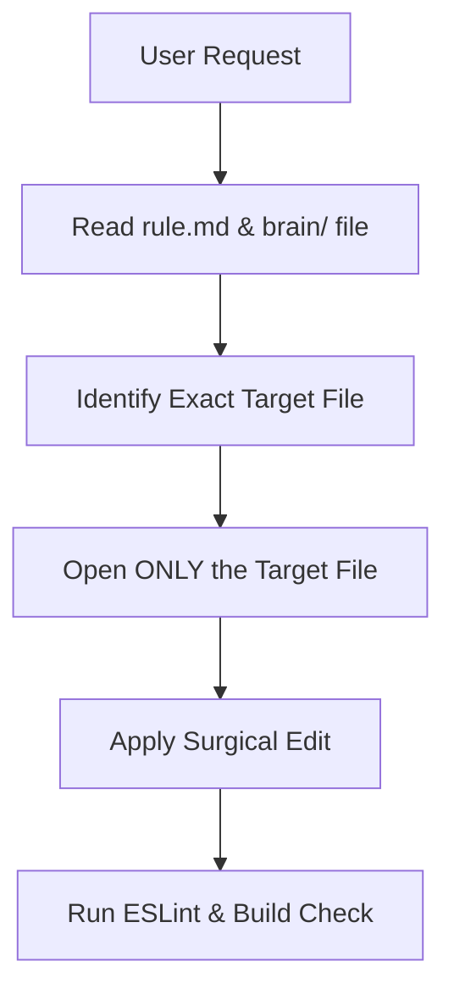

# Portfolio Project Brain (Agent Knowledge Base)

> **PURPOSE**: This directory contains high-density, authoritative architectural blueprints, component directories, data schemas, and performance guidelines for this portfolio repository.
> **RULE**: When performing any task, **read the appropriate file here first** instead of scanning the full project.

---

## Quick Navigation Index

| Topic | File | When to Read |
| :--- | :--- | :--- |
| **Architecture & State** | [`brain/architecture.md`](file:///d:/devil_code/portfolio-frontend/brain/architecture.md) | For understanding VS Code layout, Zustand state store, tab routing, and lazy chunk boundaries. |
| **Component Inventory** | [`brain/components.md`](file:///d:/devil_code/portfolio-frontend/brain/components.md) | For exact file paths, component responsibilities, props, and lazy loading status of any UI element. |
| **Data Schemas & Files** | [`brain/data_models.md`](file:///d:/devil_code/portfolio-frontend/brain/data_models.md) | For modifying projects, skills, experience, resumes, or virtual file explorer tree mappings. |
| **3D, Animations & Performance** | [`brain/performance_and_3d.md`](file:///d:/devil_code/portfolio-frontend/brain/performance_and_3d.md) | For Three.js WebGL core, 3D card tilts, particle canvas, cursor spotlight, or mobile responsiveness rules. |

---

## Standard Task Workflow

1. **Step 1**: Identify the category of the user's request.
2. **Step 2**: Read the single matching document in `brain/`.
3. **Step 3**: Open only the target source file(s) identified in `brain/components.md` or `brain/data_models.md`.
4. **Step 4**: Apply the edit while respecting performance constraints (lazy loading, 0-rerender ref animations, WebGL cleanup).
5. **Step 5**: Run `npx eslint src` or `npm run build` to verify.
